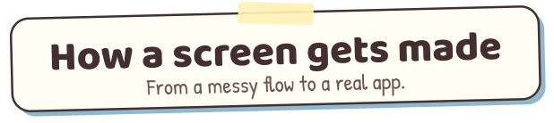

<h1 align="center">Hi 👋, I'm Manel Ayari</h1>
<h3 align="center">UX/UI Designer • Full-Stack Developer • React Native Builder • Curious about HCI</h3>

  

  
  

---

### 🎨 About Me

I'm a Computer Science graduate from Tunis who works on both sides of an app: I design it, then I build it.

- User flows, wireframes and information architecture
- High-fidelity screens and interactive prototypes in Figma
- Mobile and web apps with React Native, Expo and Next.js
- REST APIs with Node.js, Express, MongoDB and JWT authentication
- AI features that explain their answers (Gemini, Groq)

I like turning stressful everyday tasks into clear, friendly interfaces.

👉 **See my work in detail on my [portfolio](https://manelayari.vercel.app).**

---

### 💼 Experience

**RedStart Tunisie — Glutenia (Mar 2026 – Sep 2026)** 
UX/UI Designer & Full-Stack Developer · Final-year project, solo · [Case study](https://manelayari.vercel.app/work/glutenia)
- Designed a complete mobile app in Figma for 3 user roles: customers, food professionals and admins
- Built a "barcode first, AI second" scan flow with 4 clear result states that explain each flagged ingredient
- Created a gluten-free place map, an XP and badge system, and the mascot Glutitan (concept, name and story)
- Developed the full stack alone with React Native, Expo, Node.js, Express and MongoDB, over 3 Scrum sprints

**Optima Junior Entreprise — Glunity (2026)** 
Full-Stack Developer, Scanning Feature · Team project, private repository
- Built live barcode scanning in React Native (Expo Camera), backed by a Node.js and Express API that checks reviewed catalog and community products
- Integrated AI ingredient-label analysis with Groq, reading labels in Arabic, French and English and answering safe, caution, unsafe or unreadable
- Validated every AI response before showing it, with clear messages when the service is busy, slow or can't read the photo
- Added community product submissions with admin approval, so an AI result alone can never publish a product

**Optima Junior Entreprise — L'Africaine de Production Artistique (2025)** 
UX/UI Designer · [Case study](https://manelayari.vercel.app/work/lafricaine) · [Live site](https://editionapa.tn)
- Designed the full website in Figma, including an online shop and a cash-on-delivery order form
- Designed an admin back office of 20+ screens, handed off to a developer and now live

**Optima Junior Entreprise — Value (2025 – 2026)** 
Marketing Team, Web Design · [Case study](https://manelayari.vercel.app/work/value) · [Live site](https://value.com.tn)
- Led the website redesign mockups: split pages across the team, reviewed them and presented to the client
- Designed the homepage and careers page, plus post and campaign visuals

---

---

### 🔥 Focus Areas

- Mobile UX and clear interface states
- Moving from Figma to working code
- Interfaces in Arabic, French and English
- Human-computer interaction

---

### 💬 Ask Me About

- Designing "barcode first, AI second" scan flows
- XP, streaks and badges that reward useful habits
- Design hand-off between designers and developers
- React Native with a Node.js back end

---

### 🧰 Tech Stack

  

Also: React Native, Expo, Canva, Remotion, SQL, Scrum.

---

### 🎓 Education & Languages

**Licence en Informatique (GLSI)**, Faculté des Sciences de Tunis, 2026

Arabic (native) · French (fluent) · English (advanced, C1)

---

### 📫 Contact

Email: [manelayari04@gmail.com](mailto:manelayari04@gmail.com) · Portfolio: [manelayari.vercel.app](https://manelayari.vercel.app)
