<a href="https://manelayari.vercel.app"></a>

 

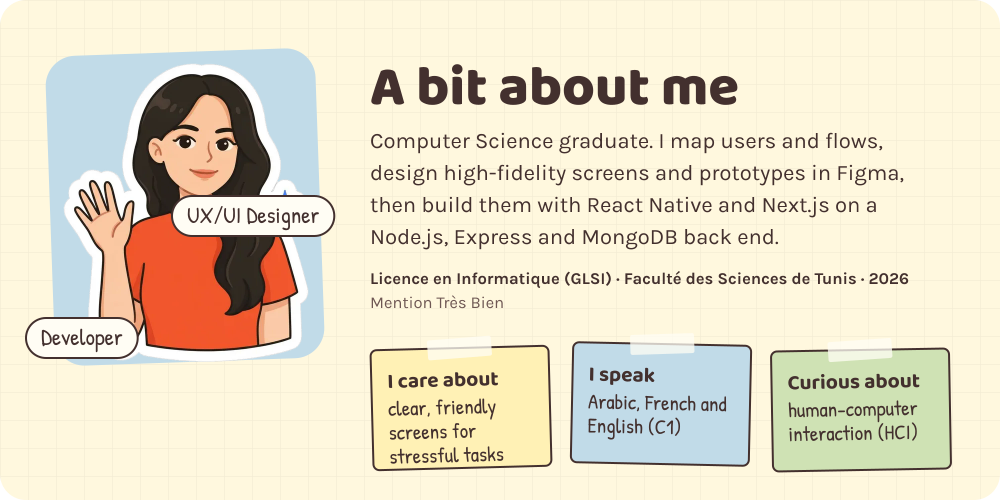

 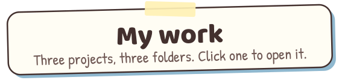

<a href="https://manelayari.vercel.app/work/glutenia">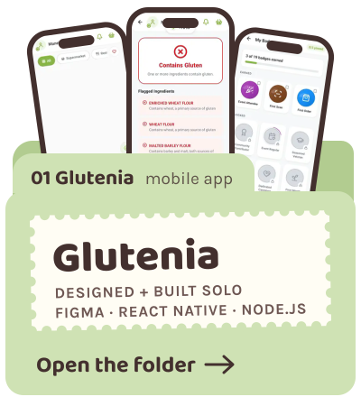</a>&nbsp;<a href="https://manelayari.vercel.app/work/lafricaine">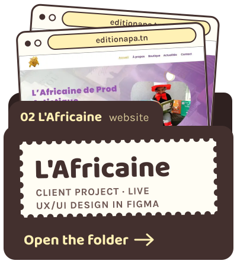</a>&nbsp;<a href="https://manelayari.vercel.app/work/value">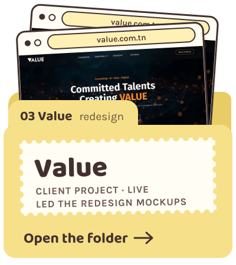</a>

 

 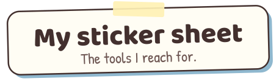

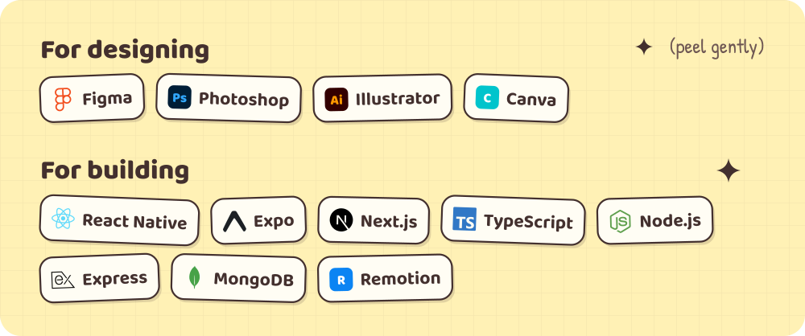

 

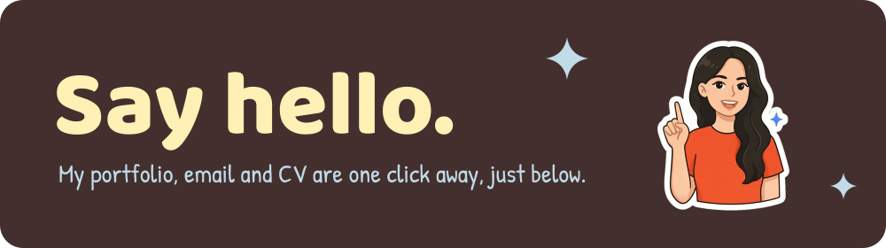

<a href="https://manelayari.vercel.app">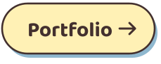</a>&nbsp;&nbsp;<a href="mailto:manelayari04@gmail.com">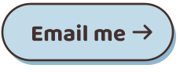</a>&nbsp;&nbsp;<a href="https://manelayari.vercel.app/manel-ayari-cv.pdf">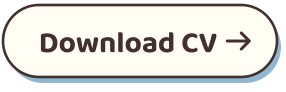</a>

Prefer plain text? This page without the animation

 

**Manel Ayari**, UX/UI Designer and Full-Stack Developer in Tunis. I design friendly apps and websites, then I build them.

- [**Glutenia**](https://manelayari.vercel.app/work/glutenia): mobile app for a gluten-free life, designed in Figma and built solo with React Native and Node.js.
- [**L'Africaine de Production Artistique**](https://manelayari.vercel.app/work/lafricaine): UX/UI design for a children's book publisher. Developed by a teammate, now live.
- [**Value**](https://manelayari.vercel.app/work/value): led the website redesign mockups for a consulting company, now live.

**Languages:** Arabic, French, English (C1) · **Email:** manelayari04@gmail.com

